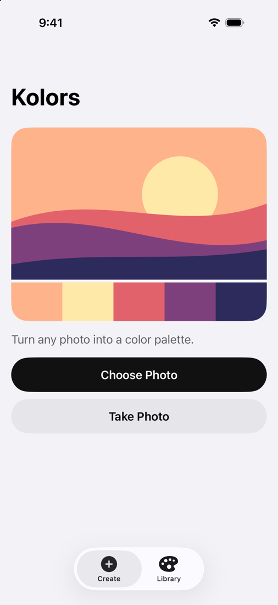
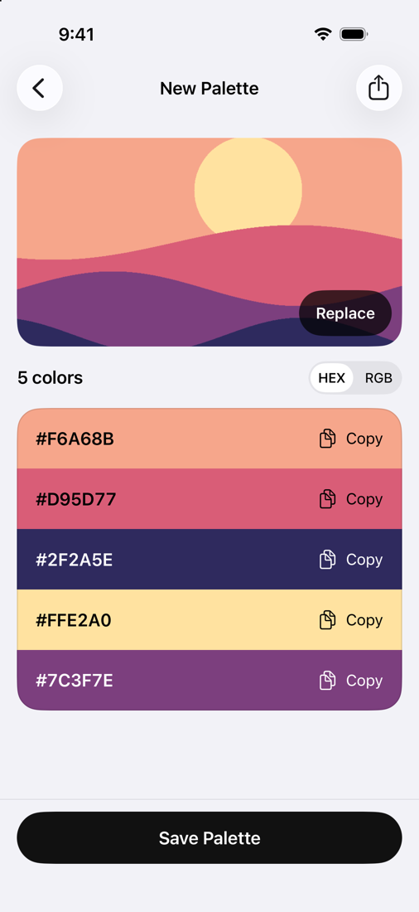
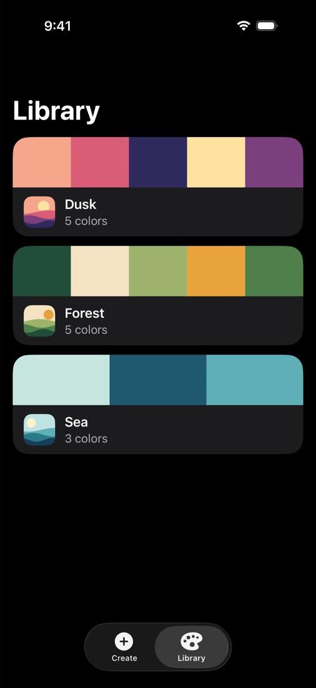

# Kolors

An iPhone app that extracts a color palette from a photo and saves it to a library.

| Create | New palette | Save | Library | Dark mode |
|---|---|---|---|---|
|  |  |  |  |  |

- Take a photo or choose one from your library.
- See up to five colors with hex and RGB values. Tap a color to copy it.
- Name a palette and save it to your library, then rename, share or delete it.

Each color is the average of a group of similar pixels, so it may not match any single pixel exactly. Simple images can produce fewer than five colors.

## Build

Requires iOS 15 or later. Open `Kolors.xcworkspace` (not the `.xcodeproj`) and run the `Kolors` scheme. `Pods/` is committed, so CocoaPods is only needed to change dependencies.

## Test

Run the `Kolors` scheme's tests in Xcode, or:

```sh
xcodebuild test -workspace Kolors.xcworkspace -scheme Kolors \
  -destination 'platform=iOS Simulator,name=<simulator name>'
```

## Data model

Version 2 of `MyKolors` stores each palette's colors as related `PaletteColor` records. `StoreMigrator` upgrades libraries from version 1. Keep the version 1 model, since the migration needs it.
