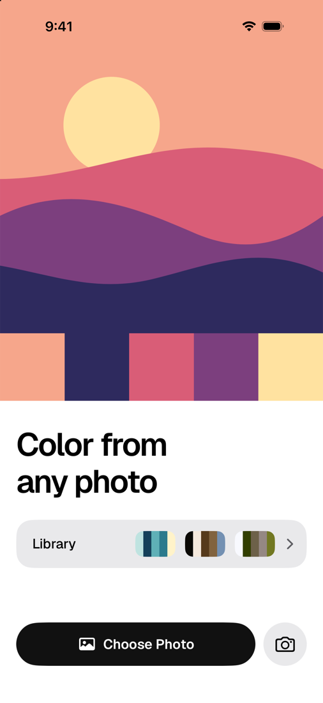
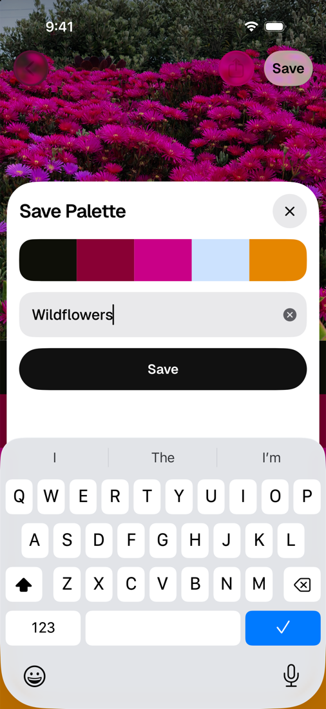
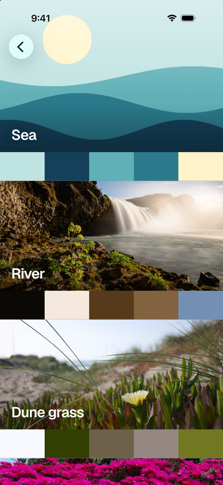
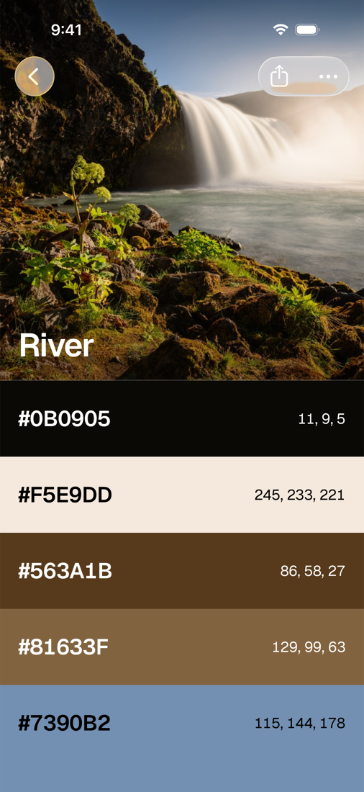
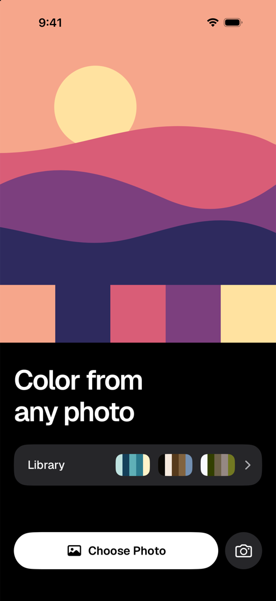

# Kolors

An iPhone app that extracts a color palette from a photo and saves it to a library.

| Home | New palette | Save | Library | Saved palette | Dark mode |
|---|---|---|---|---|---|
|  |  |  |  |  |  |

- Take a photo or choose one from your library.
- See up to five colors with hex and RGB values. Tap either value to copy it.
- Name a palette and save it to your library. Touch and hold a palette there to rename, share or delete it.

Colors are listed from most to least common. Each one is the color of a real pixel in a scaled-down copy of the photo, chosen to be clearly different from the others, so small bright details can make the palette. White is skipped, and simple images can produce fewer than five colors.

## Build

Requires iOS 15 or later. Open `Kolors.xcodeproj` and run the `Kolors` scheme. There are no third-party dependencies. The app uses the [Geist](https://github.com/vercel/geist-font) font, bundled in `Kolors/Fonts` under the SIL Open Font License.

## Test

Run the `Kolors` scheme's tests in Xcode, or:

```sh
xcodebuild test -project Kolors.xcodeproj -scheme Kolors \
  -destination 'platform=iOS Simulator,name=<simulator name>'
```

## Data model

Version 2 of `MyKolors` stores each palette's colors as related `PaletteColor` records. `StoreMigrator` upgrades libraries from version 1. Keep the version 1 model, since the migration needs it.
